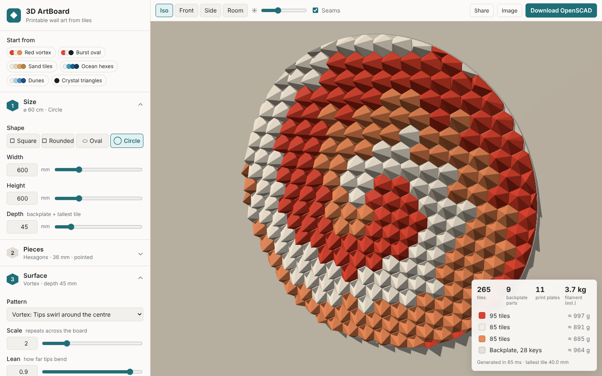
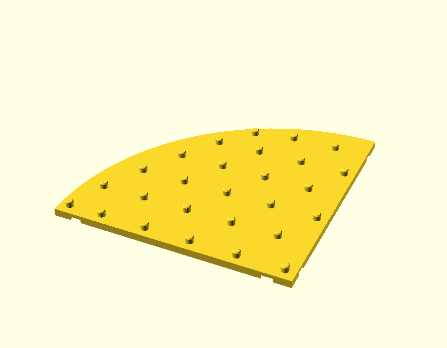
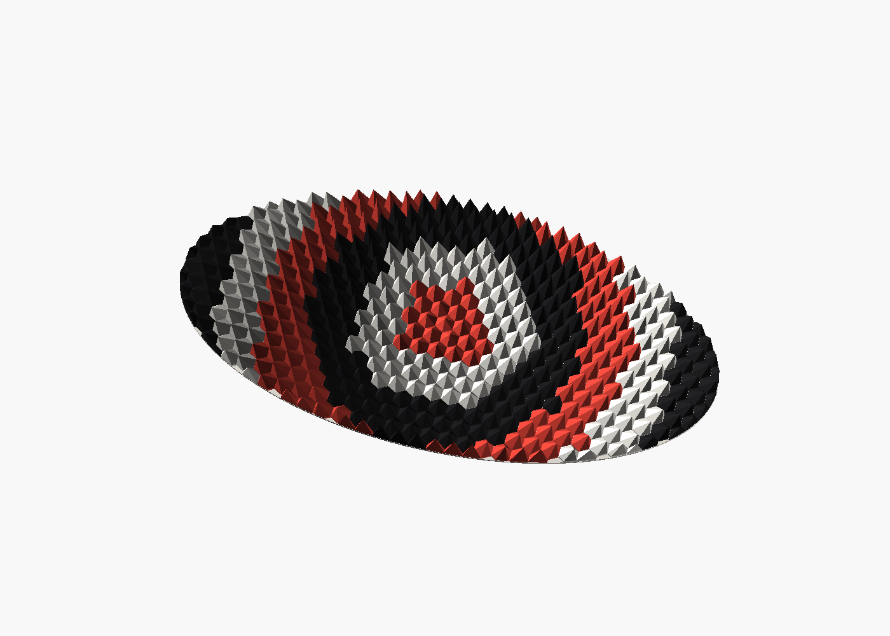

# 3D ArtBoard

Design 3D wall art from printable tiles. You pick the size, outline, tile shape,
pattern and colours; the app generates **OpenSCAD** code for every tile and for a
backplate that is cut into pieces that fit a **250 × 250 mm** bed (Bambu Lab
printers by default).



## Status

| Step | What | State |
| --- | --- | --- |
| 1 | Geometry engine and OpenSCAD generator | done |
| 2 | Web app with live 3D preview | done |
| 3 | Print export (STL/3MF per colour, assembly map, part count) | done |
| 4 | Polish and publish | next |

## What you can set

- **Size**: width and height up to 2000 mm, total depth up to 200 mm.
- **Outline**: square, rounded square, oval, circle.
- **Tiles**: squares, hexagons or triangles; size, gap, wall height, pointed or flat (tilted) tops.
- **Pattern**: pyramids, facets, dunes, ripple, burst, vortex, waves, noise. You can also set the scale, lean, twist, variation, centre and seed, and invert the heights.
- **Colours**: 1–8 colours, one per tile, mapped automatically by pattern, height, radius, angle, direction or at random, with optional mixing at the borders.
- **Mounting**: *press-fit* (pins on the backplate, sockets in the tiles) or *glue*
  (flat tiles, with tile outlines engraved in the backplate as a placing guide).

## How a board is built

- Each **tile** is one colour and prints base-down with no supports. Tips are kept inside the
  footprint so nothing overhangs.
- The **backplate** is split into a grid of sections no larger than the bed minus the margin. Seams
  are nudged so they don't cut through a pin. Sections are joined with printed **bowtie keys**
  that sit in pockets on the back.
- Parts are packed onto **plates**, one colour per plate, ready to print.
- A **fit test** part has pins and sockets at 0.05–0.3 mm clearance so you can tune the press fit
  before printing hundreds of tiles.



## The print pack

**Download print pack** builds one zip in the browser (a few seconds, no server):

- `backplate/` one STL or 3MF per backplate section, already placed on the bed
- `tiles/colour-N-…/` full plates of tiles, one colour per plate, each with a numbered plate map
- `keys/` the bowtie keys, `fit-test` to tune the press fit
- `assembly-map.svg` the board from the front with every tile numbered and the sections marked
- `tiles.csv`, `artboard.scad`, `design.json` and a `README.txt` with build steps and filament estimate

Tiles are numbered in reading order (top row first, left to right), and plates are
filled in that order, so each plate holds neighbouring tiles.

## Run it

```bash
npm install
npm run dev                                             # web app on http://localhost:5173
npm run generate -- examples/vortex-small.json          # writes out/vortex-small/artboard.scad
npm run generate -- examples/vortex-small.json --pack   # also writes the print pack zip (3MF)
npm run generate -- examples/vortex-small.json --openscad  # renders every part with OpenSCAD instead
npm test
```

Open `artboard.scad` in OpenSCAD. Set `part` (`assembly`, `section`, `tile`, `plate`, `key`,
`fit_test`) and `index` to choose what to show, or render from the command line:

```bash
openscad -D 'part="plate"' -D index=0 -o plate0.stl out/vortex-small/artboard.scad
```

## Code layout

```
src/core/params.ts     every parameter and its default
src/core/layout.ts     outline shapes and tile grid clipped to the outline
src/core/patterns.ts   pattern fields (height, lean, colour value per tile)
src/core/colors.ts     automatic colour mapping
src/core/tile.ts       tile solids (shared by the OpenSCAD output and the preview)
src/core/backplate.ts  bed-sized sections, pins, bowtie keys
src/core/packing.ts    print-plate packing
src/core/scad.ts       OpenSCAD emitter
src/core/mesh.ts       printable meshes (tiles with sockets, backplate layers, pins, keys)
src/core/export.ts     STL, 3MF, assembly and plate maps, print pack zip
src/core/design.ts     puts it together, checks limits, filament estimate
src/app/               web app: parameter panel, three.js preview, downloads
```

The app keeps the whole design in the page link, so **Share** copies a URL that
reopens exactly the same board. **Save design** and **Load design** use a small JSON file.


